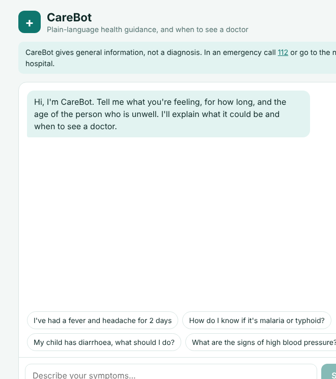
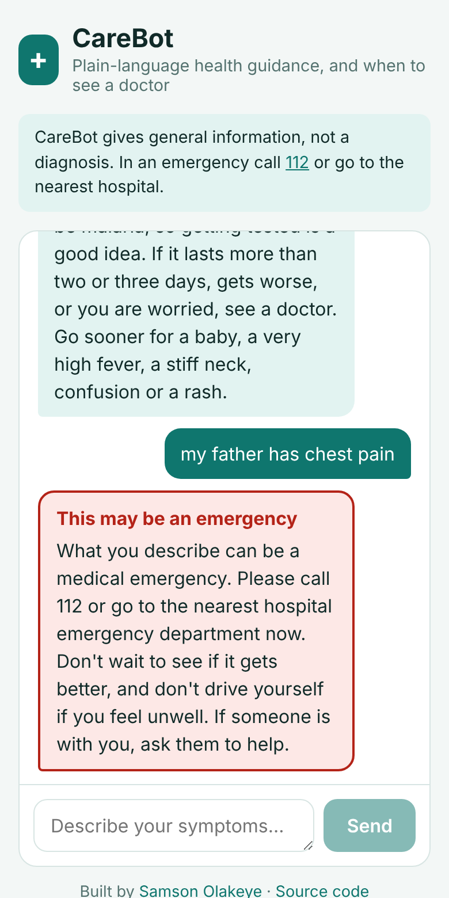

# CareBot

**An AI health assistant that explains common symptoms in plain language and says when to see a doctor.** Built for people in Nigeria, where a clinic visit is not always easy and a fever could be many things.

**Live app:** [care-bot-fk6o.vercel.app](https://care-bot-fk6o.vercel.app)



> CareBot gives general health information, not a diagnosis. In an emergency, call 112 or go to the nearest hospital.

## How it keeps people safe

1. **Emergencies are caught by rules, before any AI runs.** Chest pain, trouble breathing, stroke signs, seizures, fainting, heavy bleeding, poisoning, a stiff neck with fever, and thoughts of self-harm get an immediate, fixed message to call 112 or go to an emergency department ([`lib/emergency.ts`](lib/emergency.ts)). This never depends on the model, an API key or a network call.
2. **The model is told what it may not do.** It does not diagnose, does not give doses for prescription medicines or for children, encourages testing for malaria and typhoid before treatment, and says when to see a doctor ([`lib/prompt.ts`](lib/prompt.ts)).
3. **It never just fails.** If the AI is unavailable or no key is set, CareBot answers from a small set of reviewed answers ([`lib/offline.ts`](lib/offline.ts)).
4. **The key stays on the server.** The browser talks to `/api/chat`; only the server calls Gemini, with the key in a header.
5. **Inputs are checked and limited.** Up to 12 messages of 1,000 characters each, no injected system messages, and a per-visitor hourly limit.



## Tech

Next.js 16, React 19, TypeScript, Google Gemini (`gemini-2.5-flash` by default), Vitest. **25 tests** cover the emergency rules (including false alarms), the AI request, fallbacks, input checks and the rate limit.

## Run it

```bash
git clone https://github.com/SamOpera/CareBot.git
cd CareBot
npm install
cp .env.example .env.local   # add GEMINI_API_KEY from Google AI Studio
npm run dev
```

Without a key it still runs, using the offline answers.

| Command | What it does |
| --- | --- |
| `npm run dev` | Start the dev server |
| `npm test` | Run the tests |
| `npm run build` | Production build |

## History

`legacy-v1/` holds the first version (2025): a browser-only React app that matched questions against a fixed list.

---

Built by [Samson Olakeye](https://samsonolakeye.com) · [GitHub](https://github.com/SamOpera) · [X](https://x.com/TheSamOpera)
